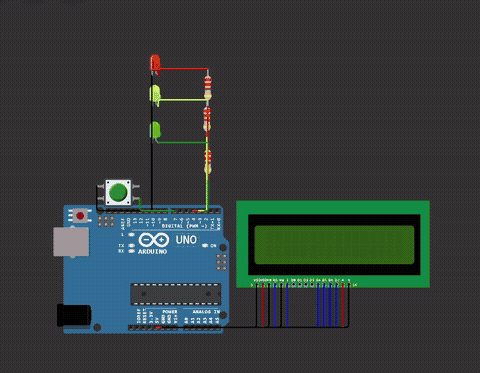

 

<a href="https://wokwi.com/projects/448014990246792193">Simular no Wokwi</a>

  

 

### Sobre o projeto

Protótipo desenvolvido na **Global Solution 2025 da FIAP**, na disciplina de Edge Computing & Computer Systems, dentro do projeto **SkillShift**, sobre requalificação profissional e o futuro do trabalho.

O dispositivo mostra, com um semáforo de LEDs e um display LCD, **o risco de automação por inteligência artificial em 14 áreas profissionais**, para conscientizar trabalhadores e incentivar a requalificação.

 

### Como funciona

1. Ao ligar, o LCD apresenta a legenda das cores.
2. Cada clique no botão mostra a próxima profissão.
3. O LED aceso e a segunda linha do LCD indicam o risco: **verde** para baixo, **amarelo** para moderado e **vermelho** para alto.
4. Depois da última profissão, a lista recomeça.

<b>Ver as 14 profissões</b>

 

| Profissão | Risco | Profissão | Risco |
|:---|:---:|:---|:---:|
| Administração e Backoffice | Alto | Mídia e Conteúdo | Moderado |
| Desenvolvimento de Software | Baixo | Logística e Transporte | Alto |
| Atendimento e Serviços | Alto | Enfermagem | Baixo |
| Indústria e Manufatura | Moderado | Agronegócio Operacional | Moderado |
| Varejo e Comércio | Alto | Manutenção e Serviços Técnicos | Moderado |
| Ciência de Dados | Baixo | Jurídico Operacional | Moderado |
| Finanças Operacionais | Alto | Saúde Operacional | Baixo |

 

### Tecnologias

  
   
  Arduino Uno · C++ · LiquidCrystal · Wokwi

 

### Circuito

| Componente | Ligação |
|:---|:---|
| LEDs verde, amarelo e vermelho | Pinos 2, 3 e 4, com resistores de 220 Ω |
| Botão | Pino 7, com `INPUT_PULLUP` (dispensa resistor externo) |
| Display LCD 16x2 | Pinos A0 a A5, comunicação paralela de 4 bits |

Destaques do código: dados das profissões em vetores fáceis de atualizar, *debounce* de 300 ms no botão e navegação circular.

 

### Como executar

- **Online:** abra o [projeto no Wokwi](https://wokwi.com/projects/448014990246792193) e clique em *Start Simulation*.
- **Na placa:** abra o `sketch.ino` na Arduino IDE, monte o circuito do `diagram.json` e envie para o Arduino.

 

### Próximos passos

- Trocar o Arduino por um ESP32 para publicar, via MQTT, as profissões mais consultadas.
- Buscar a base de profissões em uma API REST, sem precisar regravar a placa.

 

### Equipe

Camile Silva &nbsp;·&nbsp; Gustavo Ferreira &nbsp;·&nbsp; Lucas Caetano &nbsp;·&nbsp; Marco Conte &nbsp;·&nbsp; Sofia Rodrigues

